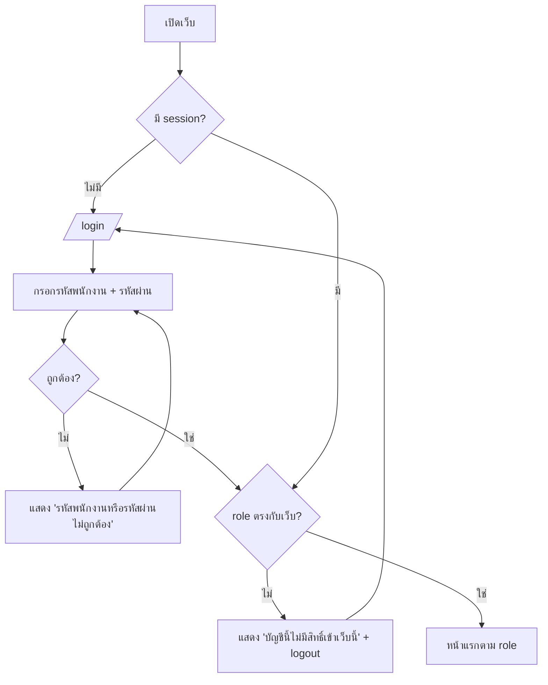
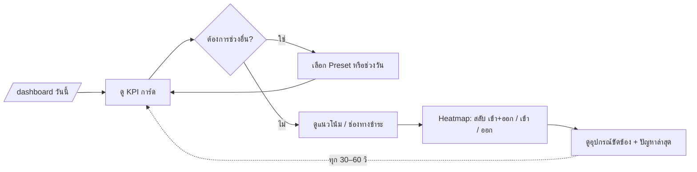
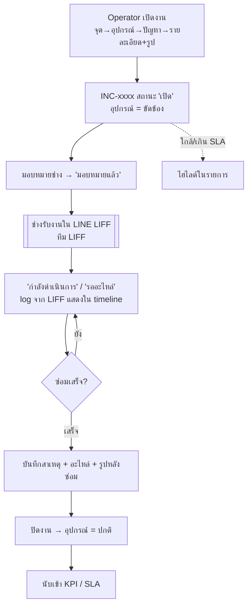
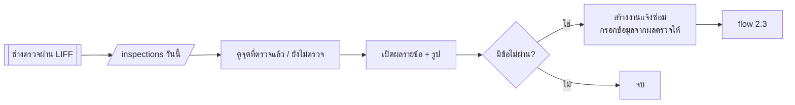
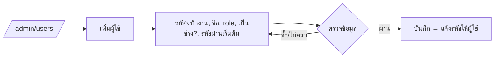

# User Story & User Flow

## 1. User Stories

### ผู้บริหาร (`executive`) — เว็บ Executive

| ID | User Story | เกณฑ์ยอมรับ |
| --- | --- | --- |
| US-E1 | ในฐานะผู้บริหาร ฉันต้องการ login ด้วยรหัสพนักงาน เพื่อดู Dashboard | login สำเร็จแล้วไป `/dashboard`, รหัสผิดแสดงข้อความ, บัญชี admin/operator เข้าไม่ได้ |
| US-E2 | ฉันต้องการเห็นรายได้วันนี้เทียบกับเมื่อวาน เพื่อรู้ผลประกอบการทันที | การ์ดแสดงยอดเงินบาทและ % เปลี่ยนแปลงพร้อมลูกศรขึ้น/ลง |
| US-E3 | ฉันต้องการเลือกช่วงเวลา (Preset หรือเลือกเอง) เพื่อดูข้อมูลย้อนหลัง | ทุก widget เปลี่ยนตามช่วงที่เลือก, ค่าเริ่มต้นเป็น "วันนี้" |
| US-E4 | ฉันต้องการเห็นสัดส่วนช่องทางชำระเงิน เพื่อวางแผนช่องทางรับเงิน | แสดงยอดเงินและ % ต่อช่องทาง |
| US-E5 | ฉันต้องการเห็นแนวโน้มรายได้ เพื่อดูทิศทางธุรกิจ | กราฟรายวันพร้อม tooltip |
| US-E6 | ฉันต้องการดู Heatmap ปริมาณรถรายชั่วโมงแยกจุด เพื่อรู้ช่วงเวลาและจุดที่หนาแน่น | สลับมุมมอง เข้า+ออก / เข้า / ออก ได้ |
| US-E7 | ฉันต้องการเห็นอุปกรณ์ที่ขัดข้องและปัญหาล่าสุด เพื่อรู้ว่ามีอะไรกระทบการให้บริการ | แสดงจำนวนขัดข้องแยกจุดกับรายการงานที่ยังเปิด |
| US-E8 | ฉันต้องการให้ข้อมูลอัปเดตเอง เพื่อเปิดจอทิ้งไว้ได้ | ดึงข้อมูลใหม่ทุก 30–60 วินาที และแสดงเวลาอัปเดตล่าสุด |

### เจ้าหน้าที่ CIT (`operator`, `admin`) — เว็บ Service

| ID | User Story | เกณฑ์ยอมรับ |
| --- | --- | --- |
| US-S1 | ในฐานะ operator ฉันต้องการ login แล้วเห็นงานแจ้งซ่อมทันที | ไป `/incidents`, บัญชี executive เข้าไม่ได้ |
| US-S2 | ฉันต้องการเปิดงานแจ้งซ่อมพร้อมรูป เมื่อได้รับแจ้งปัญหา | ได้เลขงาน `INC-xxxx` และอุปกรณ์เปลี่ยนเป็น "ขัดข้อง" |
| US-S3 | ฉันต้องการมอบหมายงานให้ช่าง | สถานะเปลี่ยนเป็น "มอบหมายแล้ว" ช่างเห็นงานใน LIFF (ทีม LIFF ทำ) |
| US-S4 | ฉันต้องการเห็นงานที่ใกล้หรือเกิน SLA ก่อน | งานเหล่านี้ถูกไฮไลต์และเรียงขึ้นก่อน กรองได้ |
| US-S5 | ฉันต้องการติดตาม log ที่ช่างอัปเดตจากหน้างาน | timeline แสดง log จากทั้ง web และ LIFF |
| US-S6 | ฉันต้องการปิดงานพร้อมสาเหตุและรูปหลังซ่อม | ปิดไม่ได้ถ้าขาดข้อมูล, อุปกรณ์กลับเป็น "ปกติ" |
| US-S7 | ฉันต้องการดูว่าวันนี้จุดไหนตรวจเช็กแล้ว/ยังไม่ตรวจ และข้อไหนไม่ผ่าน | สรุปรายวันพร้อมรายละเอียดรายข้อ, สร้างงานซ่อมจากข้อไม่ผ่านได้ |
| US-S8 | ฉันต้องการดู KPI ของช่างและ % ผ่าน SLA | ตารางรายช่าง + กราฟตามช่วงเวลา |
| US-S9 | ในฐานะ admin ฉันต้องการสร้างบัญชีและกำหนด role | สร้าง/แก้/ปิดใช้งาน/รีเซ็ตรหัสผ่านได้ |
| US-S10 | ในฐานะ admin ฉันต้องการจัดการจุด, อุปกรณ์, เทมเพลตตรวจเช็ก, ประเภทปัญหา และค่า SLA | CRUD ครบ, operator มองไม่เห็นเมนูนี้ |

## 2. User Flows

### 2.1 Login (ทั้งสองเว็บ)

### 2.2 ผู้บริหารดู Dashboard

### 2.3 วงจรงานแจ้งซ่อม (Service + LIFF)

### 2.4 ตรวจเช็กประจำวัน

### 2.5 Admin สร้างบัญชี

