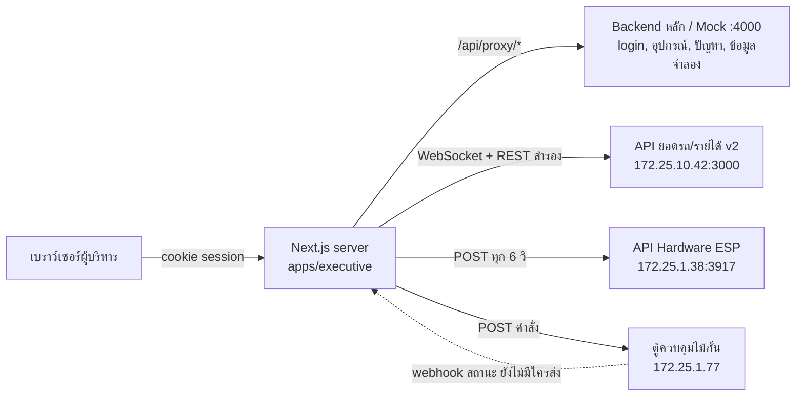
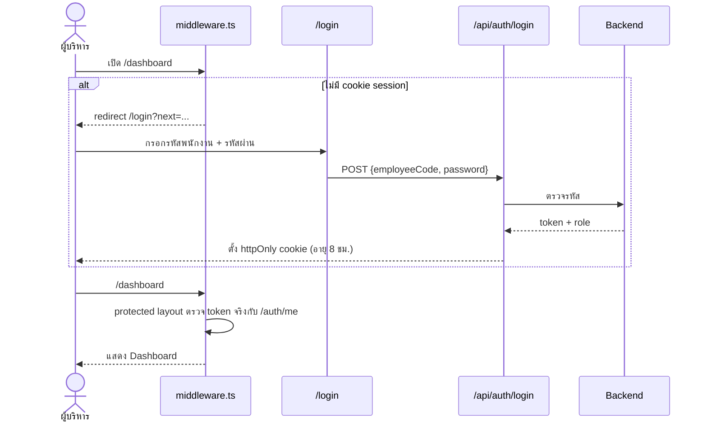
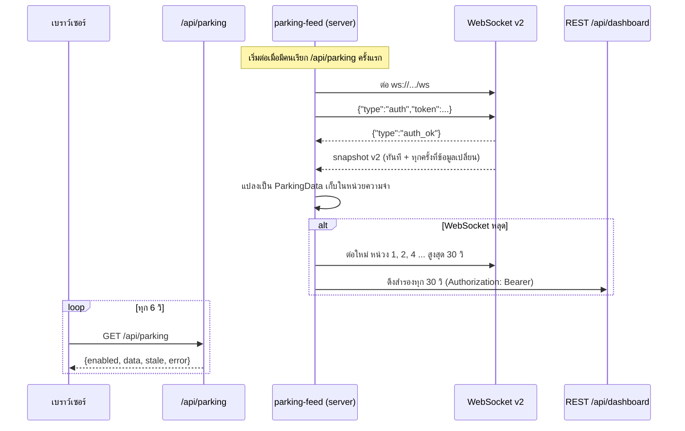
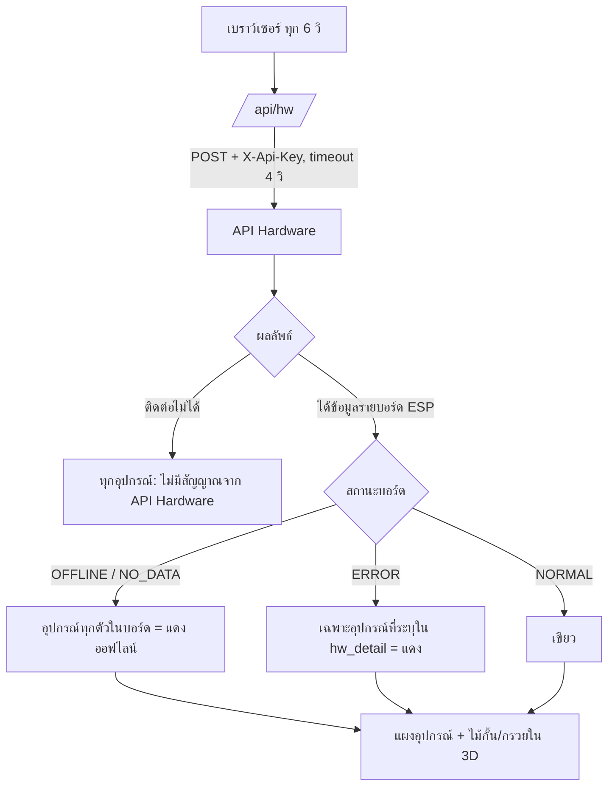
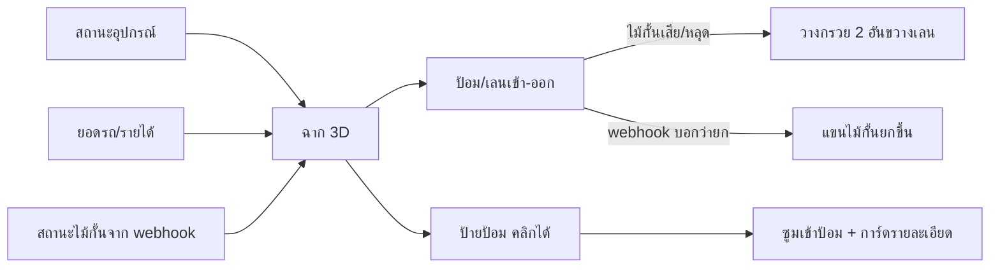
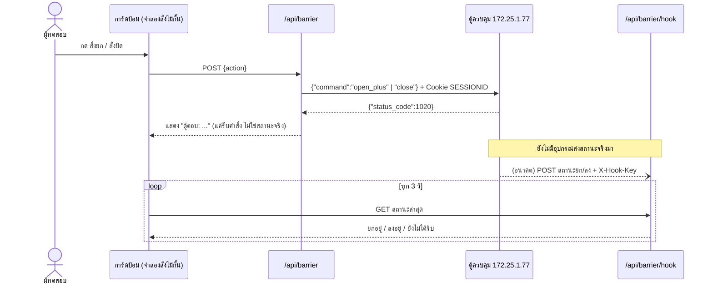

# Flow การทำงานของเว็บ Dashboard ผู้บริหาร

> เว็บเดียวใน repo นี้คือ **Executive** (`apps/executive`, พอร์ต 3000)
> เว็บ Service แยกไปให้อีกทีมพัฒนาแล้ว ดูสเปกที่ [service-web.md](service-web.md)
> อัปเดตล่าสุด: 27 ต.ค. 2026

## 1. ภาพรวม

เบราว์เซอร์ **ไม่คุยกับระบบภายนอกโดยตรง** ทุกคำขอผ่าน server ของ Next.js ก่อน เพื่อเก็บ token และรหัสลับไว้ฝั่ง server เท่านั้น

| ระบบภายนอก | ใช้ทำอะไร | Route ฝั่งเรา | ตั้งค่าใน `.env.local` |
| --- | --- | --- | --- |
| Backend หลัก (ตอนนี้ใช้ Mock :4000) | login, รายการอุปกรณ์, ปัญหาล่าสุด, ข้อมูลที่ยังไม่มีของจริง | `/api/auth/*`, `/api/proxy/*` | `API_MODE`, `API_BASE_URL` |
| API ยอดรถ/รายได้ v2 | รายได้, รถเข้า/ออก/คงค้าง, กราฟ 30 วัน, Heatmap | `/api/parking` | `CIT_PARKING_WS_URL`, `CIT_PARKING_WS_TOKEN`, `CIT_PARKING_REST_URL` |
| API Hardware (ESP) | สถานะอุปกรณ์รายบอร์ด | `/api/hw` | `CIT_HW_URL`, `CIT_HW_KEY` |
| ตู้ควบคุมไม้กั้น | ทดสอบสั่งยก/ปิด | `/api/barrier` | `CIT_BARRIER_URL`, `CIT_BARRIER_SESSION`, `CIT_BARRIER_SITE` |
| (รอทีมตู้) | รับสถานะไม้กั้นจริง | `/api/barrier/hook` | `CIT_BARRIER_HOOK_KEY` |

ถ้าไม่ตั้งค่าของระบบไหน หน้าเว็บจะใช้ข้อมูลจำลองแทนส่วนนั้นอัตโนมัติ

## 2. Flow การเข้าสู่ระบบ

- สิทธิ์ที่เข้าได้: `executive` และ `admin`
- token อยู่ใน httpOnly cookie เท่านั้น JavaScript ฝั่งเบราว์เซอร์อ่านไม่ได้
- session หมดอายุหรือ token ใช้ไม่ได้ → กลับหน้า login พร้อมข้อความ `?reason=expired`
- ออกจากระบบ → ลบ cookie แล้วไป `/login?reason=logout`

## 3. หน้าจอ Dashboard และแหล่งข้อมูลแต่ละส่วน

หน้าเดียว แสดงข้อมูล **วันนี้** เสมอ (ไม่มีตัวเลือกช่วงเวลา) เรียงจากบนลงล่าง:

| ลำดับ | ส่วน | ข้อมูลจาก | ความถี่ |
| --- | --- | --- | --- |
| 1 | การ์ด รายได้ / รถเข้า / รถออก / รถคงค้างในลาน | API v2 (`revenue`, `cars`) | ทุก 6 วิ |
| 2 | แผนผังลาน 3D (เฉพาะจอ ≥ 768px) | API Hardware + API v2 + สถานะไม้กั้น | ทุก 6 วิ |
| 3 | กราฟแนวโน้มรายได้ 30 วัน | API v2 (`trend`) | ทุก 6 วิ |
| 4 | ยอดรับเงินตามจุดรับเงิน | ข้อมูลจำลอง (รอตารางแมปช่องทาง) | ตาม `NEXT_PUBLIC_POLL_INTERVAL_MS` |
| 5 | Heatmap ปริมาณรถรายชั่วโมง | API v2 (`hourly`) | ทุก 6 วิ |
| 6 | สถานะอุปกรณ์ แยกตามเลนเข้า/ออก/Kiosk | API Hardware | ทุก 6 วิ |
| 7 | ปัญหาล่าสุด | Backend หลัก / Mock | ตาม `NEXT_PUBLIC_POLL_INTERVAL_MS` |

การดึงข้อมูลทั้งหมดใช้ TanStack Query และ **หยุดเองเมื่อแท็บไม่ได้เปิดอยู่**

## 4. Flow ยอดรถและรายได้ (API v2)

กฎการแสดงผล (ตามคู่มือ API v2):

- **รายได้** ใช้ `revenue.today` ตรง ๆ (หักส่วนลดมาแล้ว ห้ามหักซ้ำ)
- **เทียบเมื่อวาน** แสดง "เทียบ <วันที่> เวลาเดียวกัน" เมื่อ `vs_yesterday_pct` ไม่เป็น null ถ้าเป็น null ซ่อนบรรทัดนี้
- **รถคงค้าง** ใช้ `cars.parked` (สะสมข้ามวัน ไม่รีเซ็ตตอนเที่ยงคืน) ส่วนรถเข้า/ออกรีเซ็ตเป็น 0 ทุกเที่ยงคืน
- **กราฟ 30 วัน** ช่วงวันที่ใช้ `trend.from`/`trend.to` จบที่เมื่อวาน
- **Heatmap** เป็นจำนวนจริงของวันนี้ (ไม่ใช่ค่าเฉลี่ย) ชื่อแถวเป็น label ดิบจาก Backend จนกว่าจะมีตารางแมปป้อม
- **ข้อมูลเก่า** ถ้า `sync.last_ok` เก่าเกิน 3 นาที แสดงแถบ "ข้อมูลอาจไม่เป็นปัจจุบัน" และคงตัวเลขเดิมไว้บนจอ
- รองรับ snapshot รูปแบบเดิม (v1) ด้วย ถ้า Backend ย้อนกลับ เว็บจะไม่พัง

## 5. Flow สถานะอุปกรณ์ (API Hardware)

- สีมีแค่ **เขียว (ปกติ)** กับ **แดง (มีปัญหา/ออฟไลน์)**
- บอร์ด ESP ต่อเลน: ESP-001..007 = เลนเข้า, ESP-008..014 = เลนออก, ESP-015..017 = Kiosk 1–3 (สมมติไว้ รอ Backend ยืนยัน)
- ลำดับอุปกรณ์คงที่ ไม่ย้ายตัวที่แดงขึ้นบน และไม่แสดงรหัส ESP ให้ผู้ใช้เห็น
- ใน Console ของเบราว์เซอร์มีตาราง log ข้อมูลที่ API ส่งมาทุกรอบ

## 6. Flow แผนผังลาน 3D

- โหลดเฉพาะจอ ≥ 768px (แท็บเล็ตและคอมพิวเตอร์) มือถือไม่โหลดเลย
- กล้องมุมสูงแบบ isometric: ลากซ้าย = หมุน, ลากขวา = เลื่อน, ลูกกลิ้ง = ซูม (ซูมออกได้ไม่เกินภาพรวม)
- กดป้ายป้อม → ซูมเข้าป้อมนั้น ปุ่มรีเซ็ตกลับภาพรวม
- กลางคืน ผับฝั่งถนนเปิดไฟนีออน

## 7. Flow ไม้กั้น (ทดสอบ)

- ไม้กั้นใน 3D ขยับตาม **สถานะที่ไม้กั้นแจ้งกลับ** เท่านั้น ไม่ได้ขยับตามการกดปุ่ม
- `status_code` 1020 / 1010 แปลว่าตู้รับคำสั่งแล้ว ไม่ได้ยืนยันว่าแขนขยับจริง
- **ค้างอยู่:** ต้องให้ทีมตู้ส่งสถานะจริงมาที่ hook หรือมีคำสั่งอ่านสถานะให้เราถาม

## 8. การรับมือเมื่อมีปัญหา

| สถานการณ์ | หน้าเว็บแสดง |
| --- | --- |
| API v2 ยังไม่ส่ง snapshot แรก | skeleton (กำลังโหลด) ที่การ์ดตัวเลข |
| API v2 ข้อมูลเก่าเกิน 3 นาที / หลุด | แถบ "ข้อมูลอาจไม่เป็นปัจจุบัน" + ตัวเลขล่าสุดค้างไว้ |
| API Hardware ติดต่อไม่ได้ | อุปกรณ์ทุกตัว "ไม่มีสัญญาณจาก API Hardware" + ข้อความแจ้งในแผง |
| Backend หลักผิดพลาด | ส่วนนั้นแสดงข้อความผิดพลาด + ปุ่มลองใหม่ ส่วนอื่นยังใช้งานได้ |
| session หมดอายุ | กลับหน้า login พร้อมข้อความ "เซสชันหมดอายุ" |

## 9. สิ่งที่ยังรอข้อมูล

| เรื่อง | รอจาก | ผลเมื่อได้ |
| --- | --- | --- |
| ตารางแมป `id` ช่องทาง → ป้อม / Kiosk | Backend + หน้างาน | สถิติรายป้อมใน 3D, ชื่อแถว Heatmap, แผงจุดรับเงินใช้ข้อมูลจริง |
| ความหมาย `c`, `qr`, `edc`, `mem` | หน้างาน | ชื่อช่องทางชำระเงิน |
| กรอง `sim`, `sync-test` ออก | Backend | Heatmap ไม่มีข้อมูลทดสอบปน |
| ตาราง ESP → เลน ที่ยืนยันแล้ว | Backend Hardware | สถานะอุปกรณ์ตรงเลนจริง |
| แหล่งสถานะไม้กั้นยก/ลงจริง | ทีมตู้ควบคุม | ไม้กั้นใน 3D ขยับตามของจริง |
